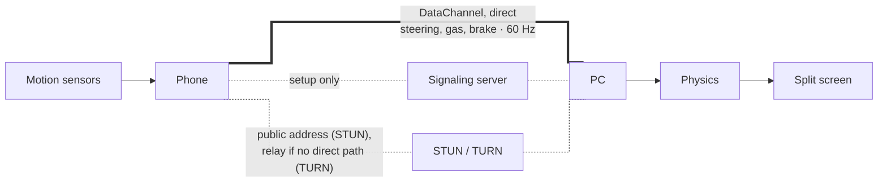
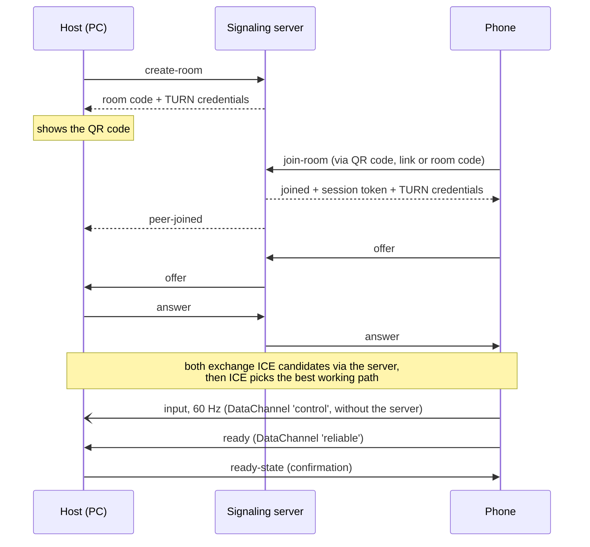

# ApiRacer

[](https://stud.messy-desk-studio.de)     

ApiRacer is a multiplayer racing game for a shared screen: the PC shows the race in split screen, and every player steers their car by **tilting their phone**. Players join by scanning a QR code, no app needed. Each phone reads its motion sensors (**Device Orientation Events**) and sends steering, gas and brake directly to the PC over a **WebRTC DataChannel**, 60 times per second.

**The connection is the game:** without it there is no controller. Up to four phones drive, more phones join as spectators, and the PC keeps everyone's state in sync: who is in the room, who is ready, when the race starts and ends.

Besides the race, the project contains a **3D demo** that mirrors the full orientation of every connected phone on the PC, and a **sensor check** page that compares the orientation APIs of the device.

> [!TIP]
> **Live demo:** [stud.messy-desk-studio.de](https://stud.messy-desk-studio.de), works over Wi-Fi and mobile data. See [Try it online](#try-it-online).

## Contents

- [Try it online](#try-it-online)
- [How the connection works](#how-the-connection-works)
- [Feedback in the interface](#feedback-in-the-interface)
- [Conflict management](#conflict-management)
- [Access controls](#access-controls)
- [Fallbacks](#fallbacks)
- [Run it locally](#run-it-locally)
- [Project structure](#project-structure)
- [Required browsers and devices](#required-browsers-and-devices)
- [Limitations](#limitations)
- [Documentation used](#documentation-used)

## Try it online

No installation needed. You need a PC (host) and at least one phone.

**Race**

1. On the PC, open [stud.messy-desk-studio.de](https://stud.messy-desk-studio.de) and choose **Create Race**. The page shows a room code and a QR code.
2. Scan the QR code with your phone (Wi-Fi or mobile data both work), or open **Join Race** and type the room code.
3. If the phone shows **Bewegungssensoren freigeben**, tap **Sensoren freigeben** and allow motion sensor access (iPhone asks for this).
4. Hold the phone in landscape (turn off the rotation lock) and tap **Bereit**. Once every racer is ready, the PC can **Rennen starten**.
5. Tilt the phone to steer, the right half of the screen is **Gas**, the left half **Bremse**. The PC ends the race with **Rennen beenden**, and everyone is back in the lobby.

**3D demo**

1. On the PC, choose **3D-Handys anzeigen** and scan the QR code with one or more phones.
2. Align the model with the monitor: tap **Ausrichten starten**, lay the phone flat on the table with its top edge pointing to the monitor, then tap **Ausrichten abschließen**.

### Trying it with several phones

An order that shows the connection with several people:

1. **Join:** 2–4 people scan the QR code. Each gets a car in its own split screen view and a peer card on the host page with color, connection path and ping.
2. **Shared state:** everyone taps **Bereit**. The counter on the PC ("2/3 bereit") and the buttons on the phones change together. A fifth phone becomes a spectator.
3. **Race:** start, countdown, drive. The peer cards show steering, gas and brake live.
4. **Connection problems:** one player locks their screen. The PC shows **Verbindung verloren** with a countdown, the car stops. Unlocking within 15 s brings the same player back.
5. **TURN relay:** one phone appends `&relay=1` to the link from the QR code (`…/controller.html?room=ABCD&relay=1`). Its card shows **TURN-Relay** as the path and a higher ping.

## How the connection works

**Data path:** the game data flows directly from every phone to the PC. Two servers only help to set up the connection.



**Connection setup** in order:



1. **Create a room:** The host page connects to the signaling server via WebSocket and gets a room code. It shows the code and a QR code.
2. **Join:** The phone opens the link from the QR code (or enters the room code), connects to the signaling server as well and joins the room. It gets a session token, the host is notified.
3. **Connection setup:** The phone creates both DataChannels and a WebRTC offer that describes them, the host replies with an answer, and both exchange ICE candidates (possible network paths, see below). The phone makes the offer because it opens the channels; the host receives them. The signaling server only relays these messages and never reads them.
4. **Data:** Once connected, the phone sends its full input 60 times per second directly to the host. Every input message carries a sequence number, so the host ignores late ones. Lobby messages go over the reliable channel (see [Two DataChannels](#two-datachannels)).
5. **Reconnect:** If a phone's connection to the signaling server breaks (screen locked, network switch, reload), the server keeps its slot for 15 s, and the phone rejoins with its token and gets the same ID back. A broken WebRTC connection is restored with an ICE restart. Only if that's impossible (page reloaded, DataChannels closed) does the phone set up a new one, and the host swaps it in for the same player: car, color and role stay. Leaving on purpose (**Raum verlassen**) frees the slot right away; a closed page (close code 1001, sent by the browser) only gets 5 s, which is enough for a reload.

The network is a star: every phone connects only to the PC, and the phones never talk to each other. Rooms, peer IDs and session tokens only live in the signaling server's memory (no database); the phone keeps its session token in `sessionStorage` so it survives a reload.

### Two DataChannels

| Channel | Options | Carries | Why |
| --- | --- | --- | --- |
| `control` | `ordered: false, maxRetransmits: 0`: lost messages are not resent (like UDP) | `input {seq, steering, throttle, brake}` at 60 Hz, ping/pong for the round trip time | A lost steering value is worthless 16 ms later, the next one replaces it. Waiting for a retransmit would only add lag. |
| `reliable` | Ordered, resent until it arrives (like TCP) | `ready`, `ready-state`, `role`, `race-start`, `race-end`, `peer-color` | A lost "ready" or "race-start" must arrive, and in the right order. |

The 3D demo uses only the `control` channel and sends a quaternion (`orientation`) instead of the input. All message types are defined in [protocol.ts](src/shared/protocol.ts), the channel options in [rtc.ts](src/client/common/rtc.ts).

### Finding a path: NAT, STUN, TURN and ICE

Most devices sit behind a router that translates their private address (e.g. `192.168.…`) into one public address (**NAT**, Network Address Translation). Devices behind NAT can't be reached directly from outside, so WebRTC needs help to connect them:

- **STUN** (Session Traversal Utilities for NAT): The device asks a STUN server "how do you see me from outside?" and learns its public address. Both sides exchange these addresses and send packets to each other at the same time, which opens a path through both routers (*hole punching*). The data then flows directly, the STUN server is only needed for this one question.
- **TURN** (Traversal Using Relays around NAT): If no direct path works (e.g. strict firewalls or networks that block devices from reaching each other), the TURN server relays all traffic between the two. This works in almost every network, but costs latency and server bandwidth. The data stays end-to-end encrypted, the TURN server can't read it.
- **ICE** (Interactive Connectivity Establishment): The procedure the browser runs automatically. It collects all possible paths (*candidates*): the local address (`host`), the public address from STUN (`srflx`) and the relay address from TURN (`relay`). Then it tests pairs of them and picks the best one that works, preferring direct paths. The host page shows the chosen path for every phone.

To see the TURN relay in action, add `relay=1` to the host or phone URL (`host.html?relay=1`, `controller.html?room=ABCD&relay=1`): only relay candidates are allowed then (`iceTransportPolicy: 'relay'`), and the ping rises noticeably. Locally this makes the connection fail on purpose, because there is no TURN server.

### Infrastructure

The pages are static files on a web host. The signaling server (Node.js) and a **self-hosted STUN/TURN server** ([coturn](https://github.com/coturn/coturn)) run on a small VPS. The signaling server sits behind Caddy (HTTPS, `wss://…/ws`), coturn listens directly on port 3478 (UDP and TCP). The signaling server hands out TURN credentials to the host and every phone when they create, join or rejoin a room. Pages and signaling server are deployed via GitHub Actions on a version tag, after typecheck, build and tests passed.

## Feedback in the interface

Every action shows whether it arrived, on both sides.

**On the phone**

| Situation | What the phone shows |
| --- | --- |
| Connecting | Status line: **Verbinde mit Signaling-Server …** → **Baue WebRTC-Verbindung auf …** → **Verbunden zu ABCD** |
| Tapped **Bereit** | **⏳ Wird gemeldet …** (button locked) until the host confirms → **✅ Bereit – tippen zum Zurücknehmen** |
| Host doesn't answer within 3 s | **⚠️ Keine Antwort vom Host – tippen zum Wiederholen** |
| Made a spectator | **Zuschauer – du hast kein Auto**, the ready button disappears |
| Race running | **Rennen läuft** (spectators: **Rennen läuft – du schaust zu**), the ready button disappears until the race ends |
| WebRTC connection broken | **Verbindung unterbrochen – stelle sie wieder her …**, then back to **Verbunden zu ABCD** |
| Server and WebRTC connection lost | **Verbindung verloren – verbinde neu …** (only the server lost: no message, the car keeps driving) |
| Slot or room gone | The join screen with the reason, e.g. **Host hat den Raum geschlossen** |
| Sensors not allowed yet (iPhone) | Full screen overlay with the **Sensoren freigeben** button |
| Debug panel | Room, peer ID, connection path, raw sensor values, steering value, log |

**On the PC (host)**

- **Peer card per phone:** color, WebRTC connection state (**verbunden** / **unterbrochen**, **· ohne Server** when only the server connection is gone), connection path (e.g. **Direkt im LAN (host↔host, UDP)**) and ping, ready state, live steering, gas and brake.
- **Overlay on the card** when a phone is gone: **⚠️ Verbindung verloren – Platz bleibt noch 12 s reserviert** with a countdown bar, or **Verbindung unterbrochen – Das Handy stellt sie wieder her …**.
- **Start area:** **2/3 bereit**, the start button only gets enabled once every racer is ready, then **Countdown …** and **Rennen läuft**.
- **Log** of every event: joined, ready, connection lost, new connection, left.

## Conflict management

Several phones change shared state at the same time: everyone taps **Bereit**, players leave and come back, inputs arrive out of order. ApiRacer solves this with one rule: **the host is the single source of truth**. Phones only send requests and inputs, the host decides and tells them the result.

- **Outdated inputs:** Every input message carries the full state (not a delta) and a sequence number. The host only applies a message whose number is higher than the last one it applied, so a late packet can never overrule a newer one. A lost packet costs nothing, the next one has the full state.
- **Ready state:** The phone sends `ready {ready, seq}`, the host records it and answers `ready-state` with the same `seq`. The phone shows only what the host confirmed and ignores answers to older requests. If the host changes the state on its own (player made a spectator, phone interrupted in the lobby, race ended), it sends `ready-state` without a `seq`, and the phone follows.
- **Race phase:** Only the host starts and ends the race. A phone whose channel opens during the countdown or the race gets `race-start` right away, so it doesn't miss it.
- **Same player twice:** A duplicated tab rejoins with the same session token. The newer connection takes the slot; the older one gets `session-taken-over` and stops rejoining, otherwise the two would keep taking the slot from each other.
- **Reconnect without duplicates:** A phone that comes back gets its old peer ID. The host swaps the new WebRTC connection into the existing player instead of adding a second car.
- **Spectators:** At most four racers. A phone that joins when all cars are taken, or that the host moves to the audience, gets `role {racer: false}`; a ready request from it is answered but doesn't count.

## Access controls

| Who | May do | Enforced by |
| --- | --- | --- |
| Anyone with the room code (QR code) | Join the room as a phone | Signaling server |
| A phone with its session token | Take its own slot back after losing the connection | Signaling server (token is a random UUID, only this phone knows it) |
| A phone | Send its own input and ready state, leave the room | Host + signaling server: phones can only signal the host, never each other |
| The host | Start and end the race, make a player a spectator, end the room (by closing the page) | Host page, only the host has these controls |

**Signaling server hardening** (tested in [hardening.test.ts](server/hardening.test.ts)):

- **Room codes** have 4 characters from 32 unambiguous ones; a socket that sends 5 wrong codes or session tokens is closed.
- **Origin check** in production: only the project's own pages may connect. This keeps other websites out; a script can still fake the origin, so the limits below apply too.
- **Limits against scripts:** messages per socket (token bucket), message size (64 KiB), 16 phones per room, 500 connections in total, 10 s to join a room, heartbeat that drops dead sockets.
- **TURN credentials** are generated for every host and phone with an HMAC (TURN REST API scheme, coturn `use-auth-secret`) and expire after 12 hours. The shared secret stays on the VPS, no TURN password is in the browser code.
- The server only listens on loopback; clients reach it through the reverse proxy (Caddy with HTTPS on the VPS, Vite locally).

The **track editor** (dev only, [trackFilesPlugin.ts](trackFilesPlugin.ts)) may only write track files from the PC itself and from its own page, because the dev server is reachable in the LAN.

## Fallbacks

| Missing / broken | Fallback |
| --- | --- |
| **No direct network path** (NAT, client isolation) | ICE tests all candidate pairs and prefers direct ones (local address, public address via STUN); if none works, the **TURN relay** carries the data |
| **Signaling server connection lost** (locked screen, network switch) | The running WebRTC connection keeps going, the car still drives. The phone rejoins automatically with its token (first attempt right away, then every 2 s, up to 30 s; the server keeps the slot for 15 s) |
| **Server connection dead without a close** | The server pings every socket every 5 s and drops a phone that misses a pong; the phone reconnects when its ICE restart offer gets no answer within 5 s |
| **WebRTC connection broken** | ICE restart on the same connection (after 2 s of `disconnected`, right away on `failed`); if that's impossible, a new connection replaces it for the same player |
| **Phone stops sending** | After 500 ms without input the host releases gas and brake, so the car doesn't keep driving with the last input. The card shows the interruption |
| **Slot expired** | If the WebRTC connection still works, the phone keeps driving without the server; otherwise it joins the room as a new player |
| **Room closed** | The phone shows the join screen with the reason |
| **No absolute orientation sensor** (3D demo) | Sensor fallback chain: `deviceorientationabsolute` (Android) → `deviceorientation` + `webkitCompassHeading` (iPhone) → relative `deviceorientation` (aligned with **Ausrichten**). The race only needs the tilt (`beta`), so it uses plain `deviceorientation` |
| **Sensor access denied** (iPhone) | The overlay explains how to retry: Safari never asks again, so close the tab and open the link again |
| **No motion sensors at all** (desktop) | The page still connects, but the ready button stays hidden, so a device that can't steer can't block the start |
| **QR code doesn't work** | Type the 4-character room code on the join page |
| **Screen would lock** while steering by tilt | Screen Wake Lock, requested again whenever the page becomes visible. If the browser refuses it (Safari wants a tap), the next tap on the page tries again |
| **Browser storage blocked** | Session token and volume setting are optional, the page works without them |
| **No phone at hand** (development) | Test players on the host page, driven with WASD (dev build only) |

## Run it locally

Requirement: [Node.js](https://nodejs.org/) 22.12 or newer (developed and deployed with Node 24).

```bash
git clone https://github.com/DerKunde/ApiRacer.git
cd ApiRacer
npm install
npm run dev:https
```

This starts the signaling server and the Vite dev server with a self-signed HTTPS certificate. No configuration or `.env` file is needed.

1. On the PC, open `https://localhost:5173` and choose a host page (**Create Race**, **3D-Handys anzeigen**). The browser shows a certificate warning once, you can accept it.
2. Connect the phone to the **same Wi-Fi** and scan the QR code. It contains the PC's LAN address. If several QR codes appear (e.g. because of VPN, WSL or Docker network adapters), use the one with your Wi-Fi address, usually `192.168.…`.
3. Accept the certificate warning on the phone too.

> [!NOTE]
> **Why HTTPS?**
> Browsers only provide the orientation sensors in a secure context (HTTPS or localhost). The phone opens the page via the PC's LAN address, so it needs HTTPS. `npm run dev` (plain HTTP) is enough to test the WebRTC connection, but the phone then gets no sensor data.

> [!WARNING]
> **Windows firewall:**
> On first start, Windows may ask whether Node.js is allowed on the network. Allow it for **private networks**, otherwise the phone cannot load the page.

### Troubleshooting

- **The phone can't load the page:** Many guest networks and often **eduroam** block devices in the same Wi-Fi from reaching each other (client isolation). In such a network the local setup doesn't work, use the live demo or a phone hotspot.
- **Ports:** The page runs on `5173`, the signaling server on `3001` (only reachable from the PC itself, the page forwards `/ws` to it). If `5173` is taken, Vite switches to the next free port and prints it in the console. `3001` must be free.
- **No TURN server locally:** Phone and PC are in the same network and connect directly, so local development doesn't need one. The server only hands out TURN credentials when `TURN_URLS` and `TURN_SECRET` are set, as on the production server.

### Production build

```bash
npm run build
```

Type-checks client and server and writes the static pages to `dist/`. The production build connects to the public signaling server set in `.env.production`.

### Tests

```bash
npm test              # unit and server tests (Vitest)
npm run test:browser  # end-to-end test in headless Chrome, about 3 minutes
```

- **Server tests** ([server.test.ts](server/server.test.ts), [hardening.test.ts](server/hardening.test.ts)) start the real `server.ts` on a free port and talk to it over WebSocket, like the pages do: rooms, joining, relaying, rejoining, leaving, misbehaving clients.
- **Browser test** ([run.mjs](tests/browser/run.mjs)) runs the host and several phones as headless Chrome tabs and checks the connection problems end to end: server connection lost, ICE restart, reload, closed DataChannel, duplicated tab, ready confirmation with a lost answer, server down, slot expired, server restart, room closed, race ended during the countdown and the race. Needs Google Chrome (`CHROME_PATH` overrides the path).
- GitHub Actions runs typecheck, build and tests on every pull request ([ci.yml](.github/workflows/ci.yml)). A deploy runs them first and ships the pages built there, so what goes live is what was checked.

### Pages

| Page                          | Device | Purpose                                                                |
| ----------------------------- | ------ | ---------------------------------------------------------------------- |
| `host.html`                   | PC     | Race host: lobby with QR code, peer cards, split screen race           |
| `controller.html`             | Phone  | Race controller: steering by tilt, gas, brake, ready button            |
| `host3dPhoneOrientation.html` | PC     | 3D view of all connected phones                                        |
| `phone3dClient.html`          | Phone  | Sends the phone's rotation                                             |
| `sensors.html`                | Phone  | Checks which orientation/motion APIs the device supports               |

The start page `index.html` links all of them. The phone pages are opened via the QR code, so you don't need to type the room code or link.

## Project structure

All browser code lives in `src/client/`, the signaling server in `server/`. Every page (`*.html` in the root) has its own entry script, [index.html](index.html) links all of them.

```
server/               Signaling server and its tests
src/
├── shared/           Types shared by signaling server and browser
└── client/
    ├── common/           Used by several pages: signaling, WebRTC, host UI, sensor access
    ├── race/             Racing game: host, controller, physics, view, sound, track
    ├── orientationDemo/  3D demo: phone rotation shown live on the PC
    └── sensorCheck/      Sensor check page
tests/browser/        End-to-end test in headless Chrome
```

**Server and shared code** (`server/`, `src/shared/`, `src/client/common/`)

| File                                                               | Purpose                                                                                  |
| ------------------------------------------------------------------ | ---------------------------------------------------------------------------------------- |
| [server.ts](server/server.ts)                                      | Signaling server (WebSocket): rooms, relays offer/answer/ICE, TURN credentials, rejoins, limits |
| [server.test.ts](server/server.test.ts)                            | Tests of the signaling server: rooms, joining, relaying, rejoining, leaving              |
| [hardening.test.ts](server/hardening.test.ts)                      | Tests against misbehaving clients: broken and oversized messages, origin, limits         |
| [testServer.ts](server/testServer.ts)                              | Test helpers: starts `server.ts` in its own process, WebSocket client for the tests      |
| [protocol.ts](src/shared/protocol.ts)                              | All message types: browser ↔ signaling server and phone ↔ PC over the DataChannels       |
| [trackLayout.ts](src/shared/trackLayout.ts)                        | Track as plain data (JSON) and its validation                                            |
| [signaling.ts](src/client/common/signaling.ts)                     | WebSocket connection to the signaling server                                             |
| [session.ts](src/client/common/session.ts)                         | The phone's session token in `sessionStorage`, to get its slot back after a reload       |
| [rtc.ts](src/client/common/rtc.ts)                                 | WebRTC helpers: ICE config, the two DataChannels, applying signals, connection path      |
| [hostDashboard.ts](src/client/common/hostDashboard.ts)             | Host page UI: join links with QR code, peer cards, peer colors                           |
| [mobileDeviceSensors.ts](src/client/common/mobileDeviceSensors.ts) | Sensor access: permission, source detection, compass offset, angles to quaternion        |
| [wakeLock.ts](src/client/common/wakeLock.ts)                       | Keeps the phone's screen on while steering                                               |
| [pixelRatio.ts](src/client/common/pixelRatio.ts)                   | Canvas size on HiDPI screens and when moving the window to another screen                |
| [ui.ts](src/client/common/ui.ts)                                   | Small DOM helpers (element lookup, on-page log)                                          |

**Race** (`src/client/race/`)

| File                                                         | Purpose                                                                                     |
| ------------------------------------------------------------ | ------------------------------------------------------------------------------------------- |
| [host.ts](src/client/race/host.ts)                           | PC: accepts phones, lobby and ready state, race phases, input timeout, reconnect handling  |
| [controller.ts](src/client/race/controller.ts)               | Phone: connection and rejoin, tilt → steering, pedals, ready button, sends input at 60 Hz   |
| [steering.ts](src/client/race/steering.ts)                   | Steering logic: how the phone is held (gravity), tilt → steering value                      |
| [raceView.ts](src/client/race/raceView.ts)                   | Interface for the race view, `MAX_RACERS`                                                   |
| [threeRaceView.ts](src/client/race/threeRaceView.ts)         | three.js implementation: one scene, one chase camera per player, split screen               |
| [splitScreenLayout.ts](src/client/race/splitScreenLayout.ts) | Viewport layout per player count: full, top/bottom, 2 × 2                                   |
| [racePhysics.ts](src/client/race/racePhysics.ts)             | Rapier world with a fixed time step                                                         |
| [carPhysics.ts](src/client/race/carPhysics.ts)               | Own car model on top of Rapier: raycast suspension, tire grip, drive and brake              |
| [carModel.ts](src/client/race/carModel.ts)                   | Low poly car models built from code, in the player's color                                  |
| [raceAudio.ts](src/client/race/raceAudio.ts)                 | Synthesized engine sound per car (Web Audio API)                                            |
| [raceAudio.test.ts](src/client/race/raceAudio.test.ts)       | Unit tests of the engine sound: pitch, volume and stereo pan per viewport                  |
| [track.ts](src/client/race/track.ts), [trackGeometry.ts](src/client/race/trackGeometry.ts) | Active track, road geometry and start grid from the track's points  |
| [trackEditor.ts](src/client/race/trackEditor.ts)             | Track editor (dev only), saves via [trackFilesPlugin.ts](trackFilesPlugin.ts)               |
| [screenOrientation.ts](src/client/race/screenOrientation.ts) | Portrait/landscape detection of the screen (not used yet)                                   |

**3D demo** (`src/client/orientationDemo/`)

| File                                                                              | Purpose                                                                             |
| --------------------------------------------------------------------------------- | ----------------------------------------------------------------------------------- |
| [host3dPhoneOrientation.ts](src/client/orientationDemo/host3dPhoneOrientation.ts) | PC: accepts phones, forwards their rotation to the view                             |
| [phone3dClient.ts](src/client/orientationDemo/phone3dClient.ts)                   | Phone: picks the orientation source, sends a quaternion at 60 Hz                    |
| [orientationView.ts](src/client/orientationDemo/orientationView.ts)               | Interface for a 3D view (`addPeer` / `updatePeer` / `removePeer`)                   |
| [threeOrientationView.ts](src/client/orientationDemo/threeOrientationView.ts)     | three.js implementation: one phone model per peer in a grid                         |

**Sensor check and deployment**

| File                                                    | Purpose                                                                          |
| ------------------------------------------------------- | -------------------------------------------------------------------------------- |
| [sensorCheck.ts](src/client/sensorCheck/sensorCheck.ts) | Sensor check page: which orientation/motion APIs the device and browser support |
| [ci.yml](.github/workflows/ci.yml)                      | GitHub Actions on every PR: typecheck, build, tests                              |
| [deploy.yml](.github/workflows/deploy.yml)              | GitHub Actions: runs ci.yml, then signaling server via SSH, the pages via FTPS   |
| [apiracer-deploy.sh](deploy/apiracer-deploy.sh)         | Deploy script on the server: update, restart, rollback on failure                |

**Where to start reading:**
- **Connection setup:** [controller.ts](src/client/race/controller.ts) creates the connection and both DataChannels, [host.ts](src/client/race/host.ts) answers it. Both use the helpers in [rtc.ts](src/client/common/rtc.ts), the message flow is described at the top of [protocol.ts](src/shared/protocol.ts).
- **Signaling and rooms:** [server.ts](server/server.ts), starting with `handleMessage`.
- **Device orientation:** [mobileDeviceSensors.ts](src/client/common/mobileDeviceSensors.ts), starting with `detectOrientationSource()` (fallback chain) and `eulerToQuaternion()`.

## Required browsers and devices

| Role | Requirement | Tested |
|---|---|---|
| **Host (PC)** | Current desktop browser with WebRTC, WebGL and Web Audio | Chrome and Firefox on Windows |
| **Phone** | Browser with motion sensors (gyroscope, accelerometer) over HTTPS | iPhone 13 Pro Max, Safari |
| **Network** | Phone and PC reach each other directly, or via the TURN relay | Home Wi-Fi, mobile data, forced TURN relay |

- **iPhone/iPad:** Sensor access needs a tap on a button (permission prompt). Every browser on iOS uses Safari's engine (WebKit), so Chrome or Firefox on iPhone behave the same as Safari.
- **Android:** Not tested (no device available). The race controller uses the standard `deviceorientation` and `devicemotion` events, the 3D demo also `deviceorientationabsolute`. Chrome on Android provides them without a permission prompt, so the pages should work *(docs)*.
- **Desktop browsers as phone:** The pages load, but laptops and PCs usually have no motion sensors, so no data is sent.
- **Restrictive networks:** University or company networks may block devices from reaching each other or block UDP entirely. The TURN relay helps in the first case, but it only runs on port 3478, so a network that only allows HTTPS (port 443) blocks it too.

### Comparison: Device Orientation Events vs. Generic Sensor API

Two APIs provide the phone's orientation: the older **Device Orientation Events** (W3C spec "Device Orientation and Motion"), supported by all major browsers (with differences), and the newer **Generic Sensor API** (orientation sensors from the W3C spec "Orientation Sensor"). The comparison shows the results of the sensor check page (`sensors.html`). The Android column comes from documentation only (no device available).


**Details:**
- **Safari:** `deviceorientation` only delivers data after the permission prompt, and its `alpha` is relative to the heading at the start. The absolute heading comes from `webkitCompassHeading`.
- **Chrome on Windows:** `deviceorientation` fires a single event with all values `null`. The Generic Sensor API reports the sensor permissions as granted, but `start()` fails with `NotReadableError`.
- **Chrome on Android:** `deviceorientation` is relative, `deviceorientationabsolute` is relative to north.

**Consequences:**
- A feature being present says nothing about the sensor: on desktop, three of them exist without ever delivering data. The phone pages therefore wait for a real event with values (`detectOrientationSource()`) before they count a source as working.
- The Generic Sensor API would be the cleaner choice (`AbsoluteOrientationSensor` delivers a quaternion directly), but it is missing on iPhone and in Firefox, so the project uses the Device Orientation Events.

## Limitations

Found while building and testing the project. Entries marked *(docs)* come from documentation and were not verified on a device.

**Game**
- **No laps or finish yet:** a race runs until the host ends it. The track is flat and has no borders.
- **The room lives in the server's memory:** a restart of the signaling server (e.g. a deploy) closes all rooms, so don't deploy during a demo. Afterwards the host has to open a new room.

**Connection**
- **Peer-to-peer still needs servers:** signaling, STUN and TURN (see [How the connection works](#how-the-connection-works)). Without them, two browsers can't find each other.
- **TURN costs latency:** With the relay forced, the ping rose from a few ms to 80–300 ms, because every packet takes the detour via the server.
- **Reconnect only within 15 s:** On iPhone, locking the screen or leaving Safari drops the WebSocket without a close frame (code 1006), closing the tab or reloading sends 1001. The server can tell "connection lost" from "page closed", but not a reload from a closed tab. After the grace the host removes the player, and joining again makes a new one.
- **Browsers differ in details:** Firefox signals the end of the candidate gathering with an extra empty candidate, Chromium doesn't.

**Device orientation**
- **iOS permission:** Safari only provides sensor data after `DeviceOrientationEvent.requestPermission()`, which must be called from a tap and only works over HTTPS. Once denied, the page cannot ask again, the user has to reopen the tab *(docs)*.
- **No absolute orientation in Safari:** Safari's `alpha` is relative to the heading at start, and `event.absolute` doesn't exist. The only way to an absolute heading is the non-standard `webkitCompassHeading`.
- **The compass is unreliable:** Correcting the heading continuously with `webkitCompassHeading` made the 3D model jump by 30–40° as soon as the phone moved (magnetic interference from desk, monitor and metal; reported accuracy ±10–14°). The 3D demo therefore uses the compass only once at the start; the **Ausrichten** button resets the remaining drift.
- **Gimbal lock:** Near an upright phone position, the Euler angles alpha/beta/gamma can jump *(docs)*.
- **Screen orientation on iPhone:** `screen.orientation.lock()` is not supported, and `screen.orientation.angle` doesn't update when the phone is turned directly from one landscape side to the other. The controller therefore detects how the phone is held via gravity (`devicemotion`). On iPhone the rotation lock always means portrait, so it has to be off for playing in landscape.

**Browser detection**
- **User agent strings are unreliable** *(docs)*: browsers pretend to be other browsers and freeze version details. The project uses feature detection instead (e.g. checking which orientation events exist).

## Documentation used

**WebRTC**
- [MDN – Introduction to WebRTC protocols](https://developer.mozilla.org/en-US/docs/Web/API/WebRTC_API/Protocols): ICE, STUN, NAT and TURN
- [MDN – RTCPeerConnection() constructor, `iceTransportPolicy`](https://developer.mozilla.org/en-US/docs/Web/API/RTCPeerConnection/RTCPeerConnection#icetransportpolicy): forcing the TURN relay path
- [MDN – RTCPeerConnection: icecandidate event](https://developer.mozilla.org/en-US/docs/Web/API/RTCPeerConnection/icecandidate_event): end-of-candidates indication
- [MDN – Using WebRTC data channels](https://developer.mozilla.org/en-US/docs/Web/API/WebRTC_API/Using_data_channels): creating channels before the offer, receiving them with `ondatachannel`
- [MDN – RTCDataChannel](https://developer.mozilla.org/en-US/docs/Web/API/RTCDataChannel): `ordered` and `maxRetransmits` for reliable and unreliable channels
- [MDN – RTCPeerConnection: createOffer()](https://developer.mozilla.org/en-US/docs/Web/API/RTCPeerConnection/createOffer): the `iceRestart` option
- [MDN – RTCPeerConnection: restartIce()](https://developer.mozilla.org/en-US/docs/Web/API/RTCPeerConnection/restartIce): ICE restart after a network change
- [MDN – RTCPeerConnection: getStats()](https://developer.mozilla.org/en-US/docs/Web/API/RTCPeerConnection/getStats), [RTCTransportStats: selectedCandidatePairId](https://developer.mozilla.org/en-US/docs/Web/API/RTCTransportStats/selectedCandidatePairId) and [RTCIceCandidatePairStats](https://developer.mozilla.org/en-US/docs/Web/API/RTCIceCandidatePairStats): reading the chosen connection path for the peer cards
- [RFC 8445 – Interactive Connectivity Establishment (ICE)](https://www.rfc-editor.org/rfc/rfc8445): candidate types and how pairs are checked and chosen
- [WebRTC samples – Trickle ICE](https://webrtc.github.io/samples/src/content/peerconnection/trickle-ice/): checking which candidates a STUN/TURN server returns
- [coturn](https://github.com/coturn/coturn): self-hosted STUN/TURN server
- [coturn wiki – TURN REST API](https://github.com/coturn/coturn/wiki/turnserver#turn-rest-api): time-limited TURN credentials from a shared secret (`use-auth-secret`)

**WebSocket and signaling server**
- [MDN – CloseEvent: code](https://developer.mozilla.org/en-US/docs/Web/API/CloseEvent/code): close codes 1001 and 1006 for the reconnect grace
- [RFC 6455 – The WebSocket Protocol](https://www.rfc-editor.org/rfc/rfc6455#section-7.4.1): defined close codes (1000, 1001, 1006, 1008, 1009)
- [ws – How to detect and close broken connections](https://github.com/websockets/ws#how-to-detect-and-close-broken-connections): ping/pong heartbeat on the server
- [MDN – Window.sessionStorage](https://developer.mozilla.org/en-US/docs/Web/API/Window/sessionStorage): per-tab storage of the session token, copied when a tab is duplicated
- [Vite – Env variables and modes](https://vite.dev/guide/env-and-mode): `VITE_SIGNALING_URI` from `.env.production`
- [Vite – Server options, `server.proxy`](https://vite.dev/config/server-options#server-proxy): forwarding `/ws` to the local signaling server

**Device orientation**
- [MDN – Orientation and motion data explained](https://developer.mozilla.org/en-US/docs/Web/API/Device_orientation_events/Orientation_and_motion_data_explained): coordinate frames and the meaning of alpha, beta and gamma
- [W3C – Device Orientation and Motion, worked examples](https://www.w3.org/TR/orientation-event/#worked-examples): rotation order and converting the angles to a quaternion
- [MDN – DeviceMotionEvent: accelerationIncludingGravity](https://developer.mozilla.org/en-US/docs/Web/API/DeviceMotionEvent/accelerationIncludingGravity): gravity vector, used to detect how the phone is held
- [Apple – Safari DOM Additions: DeviceOrientationEvent](https://developer.apple.com/documentation/webkitjs/deviceorientationevent): `webkitCompassHeading` for an absolute heading on iOS
- [MDN – Sensor APIs](https://developer.mozilla.org/en-US/docs/Web/API/Sensor_APIs): feature detection for sensors
- [MDN – Secure contexts](https://developer.mozilla.org/en-US/docs/Web/Security/Secure_Contexts): why the sensors need HTTPS

**Phone and game**
- [MDN – Screen Wake Lock API](https://developer.mozilla.org/en-US/docs/Web/API/Screen_Wake_Lock_API): keeping the screen on while steering
- [MDN – Pointer events](https://developer.mozilla.org/en-US/docs/Web/API/Pointer_events): gas and brake held at the same time (one pointer per finger)
- [MDN – Web Audio API](https://developer.mozilla.org/en-US/docs/Web/API/Web_Audio_API): synthesized engine sound
- [three.js manual – Creating a scene](https://threejs.org/manual/#en/creating-a-scene): scene, camera, renderer and render loop
- [Rapier – JavaScript user guide](https://rapier.rs/docs/user_guides/javascript/getting_started_js): rigid bodies, colliders and raycasts for the car physics

**Browser detection**
- [MDN – Browser detection using the user agent](https://developer.mozilla.org/en-US/docs/Web/HTTP/Browser_detection_using_the_user_agent): why the project uses feature detection instead
- [MDN – Navigator.userAgentData](https://developer.mozilla.org/en-US/docs/Web/API/Navigator/userAgentData): User-Agent Client Hints (Chromium only)
