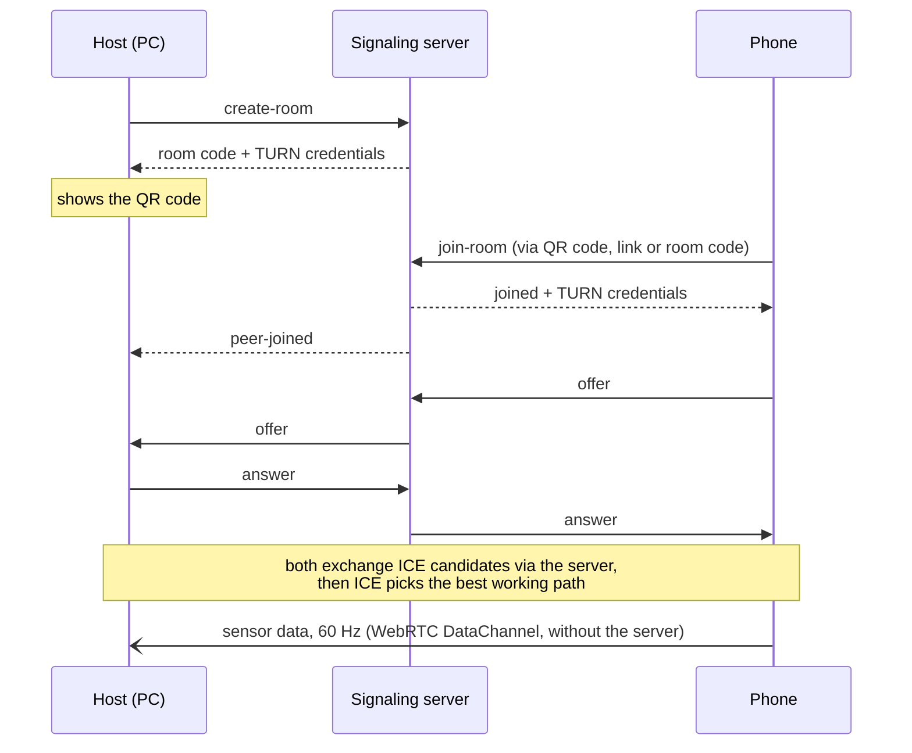
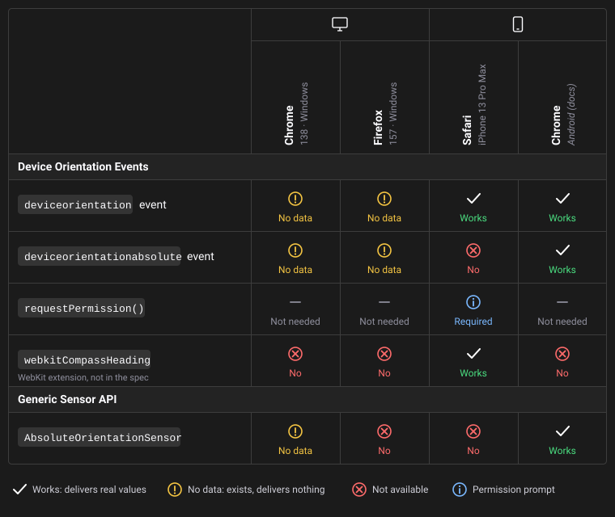

# ApiRacer

[](https://stud.messy-desk-studio.de)    

ApiRacer aims to be a multiplayer racing game for a shared screen experience: every player steers their car by tilting their phone. The PC hosts a lobby, and the players join it by scanning a QR code. Each phone reads its motion sensors via the **Device Orientation Events** and sends the steering input directly to the PC over a **WebRTC DataChannel**, without installing an app.

The game itself is not built yet. For now, ApiRacer consists of two technical demos: a **3D view** that shows the full orientation of every connected phone with three.js, and a **steering demo** that turns the phone's tilt into a steering value.

## Try it online

No installation needed:

1. On the PC, open [stud.messy-desk-studio.de](https://stud.messy-desk-studio.de) and choose **3D-Handy anzeigen**. The page shows a QR code.
2. Scan the QR code with your phone (Wi-Fi or mobile data both work).
3. Tap **Bewegungssensoren freigeben** on the phone to start the motion sensors (on iPhone this also asks for permission).
4. Hold the phone flat with its top edge pointing to the monitor and tap **Ausrichten** to align the model.

Several phones can join the same room.

## Use case

Every phone becomes a controller for a shared screen, without installing an app or needing extra hardware: scan a QR code and play. This fits anything where many people interact with one big screen at the same time:

- **Party and multiplayer games:** the planned racing game, where every player steers a car by tilting their phone
- **Lectures and events:** the audience votes or answers quizzes with gestures instead of typing
- **Presentations and exhibitions:** rotate a 3D model on the big screen (e.g. a product or museum piece) by rotating the phone

The WebRTC DataChannel suits this well: sensor values go directly from the phone to the PC with low latency, and an unordered, unreliable channel drops outdated values instead of delaying newer ones. The server only helps to set up the connection.

## How it works

Every phone connects directly to the host PC (star topology). The phones never talk to each other.



1. **Create a room:** The host page connects to the signaling server via WebSocket and gets a room code. It shows the code and additionally a QR code.
2. **Join:** The phone opens the link from the QR code (or enters the room code), connects to the signaling server as well and joins the room. The host is notified.
3. **Connection setup:** The phone creates a WebRTC offer, the host replies with an answer, and both exchange ICE candidates (possible network paths, see below). The signaling server only relays these messages.
4. **Data:** Once connected, the phone sends its sensor values 60 times per second directly to the host over a DataChannel. The channel is unordered and doesn't retransmit lost messages (`ordered: false, maxRetransmits: 0`), like UDP. Every sensor message carries a sequence number, so the host ignores late ones.

### Finding a path: NAT, STUN, TURN and ICE

Most devices sit behind a router that translates their private address (e.g. `192.168.…`) into one public address (**NAT**, Network Address Translation). Devices behind NAT can't be reached directly from outside, so WebRTC needs help to connect them:

- **STUN** (Session Traversal Utilities for NAT): The device asks a STUN server "how do you see me from outside?" and learns its public address. Both sides exchange these addresses and send packets to each other at the same time, which opens a path through both routers (*hole punching*). The data then flows directly, the STUN server is only needed for this one question.
- **TURN** (Traversal Using Relays around NAT): If no direct path works (e.g. strict firewalls or networks that block devices from reaching each other), the TURN server relays all traffic between the two. This works in almost every network, but costs latency and server bandwidth. The data stays end-to-end encrypted, the TURN server can't read it.
- **ICE** (Interactive Connectivity Establishment): The procedure the browser runs automatically. It collects all possible paths (*candidates*): the local address (`host`), the public address from STUN (`srflx`) and the relay address from TURN (`relay`). Then it tests pairs of them and picks the best one that works, preferring direct paths. The host page shows the chosen path for every phone.

To see the TURN relay in action, append `?relay=1` to the host or phone URL: only relay candidates are allowed then, and the ping rises noticeably. Locally this makes the connection fail on purpose, because there is no TURN server.

### Infrastructure

The pages are static files on a web host. The signaling server (Node.js) and a **self-hosted STUN/TURN server** ([coturn](https://github.com/coturn/coturn)) run on a small VPS. The signaling server hands out TURN credentials to the host and every phone when they create or join a room. They expire after 12 hours, so no password is stored in the browser code. Both parts are deployed via GitHub Actions.

## Run it locally

Requirement: [Node.js](https://nodejs.org/) 22.12 or newer (developed and deployed with Node 24).

```bash
git clone https://github.com/DerKunde/ApiRacer.git
cd ApiRacer
npm install
npm run dev:https
```

This starts the signaling server and the Vite dev server with a self-signed HTTPS certificate. No configuration or `.env` file is needed.

1. On the PC, open `https://localhost:5173` and choose a host page (Create Race, Show 3D-Phone). The browser shows a certificate warning once, you can accept it.
2. Connect the phone to the **same Wi-Fi** and scan the QR code. It contains the PC's LAN address. If several QR codes appear (e.g. because of VPN, WSL or Docker network adapters), use the one with your Wi-Fi address, usually `192.168.…`.
3. Accept the certificate warning on the phone too.

> [!NOTE]
> **Why HTTPS?**
> Browsers only provide the orientation sensors in a secure context (HTTPS or localhost). The phone opens the page via the PC's LAN address, so it needs HTTPS. `npm run dev` (plain HTTP) is enough to test the WebRTC connection, but the phone then gets no sensor data.

> [!WARNING]
> **Windows firewall:**
> On first start, Windows may ask whether Node.js is allowed on the network. Allow it for **private networks**, otherwise the phone cannot load the page.

### Troubleshooting

- **The phone can't load the page:** Many guest networks and often **eduroam** block devices in the same Wi-Fi from reaching each other (client isolation). In such a network the local setup doesn't work. 
- **Ports:** The page runs on `5173`, the signaling server on `3001` (only reachable from the PC itself, the page forwards `/ws` to it). If `5173` is taken, Vite switches to the next free port and prints it in the console. `3001` must be free.
- **No TURN server locally:** Phone and PC are in the same network and connect directly, so local development doesn't need one. The server only hands out TURN credentials when `TURN_URLS` and `TURN_SECRET` are set, as on the production server.

### Production build

```bash
npm run build
```

Type-checks client and server and writes the static pages to `dist/`. The production build connects to the public signaling server set in `.env.production`.

### Pages

| Page                          | Device | Purpose                                                    |
| ----------------------------- | ------ | ---------------------------------------------------------- |
| `host3dPhoneOrientation.html` | PC     | 3D view of all connected phones                            |
| `phone3dClient.html`          | Phone  | Sends the phone's rotation                                 |
| `host.html`                   | PC     | Steering wheel demo: connection path, ping, steering value |
| `controller.html`             | Phone  | Sends the steering value                                   |
| `sensors.html`                | Phone  | Checks which orientation/motion APIs the device supports   |

The start page `index.html` links all of them. The phone pages are opened via the QR code, so you don't need to type the room code or link.

## Project structure

All browser code lives in `src/client/`, the signaling server in `server/`. Every page (`*.html` in the root) has its own entry script, [index.html](index.html) links all of them.

**Shared**

| File                                    | Purpose                                                                                  |
| --------------------------------------- | ---------------------------------------------------------------------------------------- |
| [server.ts](server/server.ts)           | Signaling server (WebSocket): rooms, relays offer/answer/ICE, hands out TURN credentials |
| [protocol.ts](src/shared/protocol.ts)   | Message types shared by signaling server, host sessions and phone (client)                |
| [signaling.ts](src/client/signaling.ts) | WebSocket connection to the signaling server                                             |
| [rtc.ts](src/client/rtc.ts)             | WebRTC helpers: ICE config, DataChannel options, applying signals, connection path       |
| [ui.ts](src/client/ui.ts)               | Small DOM helpers (element lookup, on-page log)                                          |

**3D demo**

| File                                                              | Purpose                                                                             |
| ----------------------------------------------------------------- | ----------------------------------------------------------------------------------- |
| [host3dPhoneOrientation.ts](src/client/host3dPhoneOrientation.ts) | PC: accepts phones, forwards their rotation to the view                             |
| [phone3dClient.ts](src/client/phone3dClient.ts)                   | Phone: picks the orientation source, sends a quaternion at 60 Hz                    |
| [mobileDeviceSensors.ts](src/client/mobileDeviceSensors.ts)       | Sensor access: permission, source detection, compass offset, angles to quaternion   |
| [orientationView.ts](src/client/orientationView.ts)               | Interface for a 3D view (`addPeer` / `updatePeer` / `removePeer`)                   |
| [threeOrientationView.ts](src/client/threeOrientationView.ts)     | three.js implementation of the `OrientationView` interface: one phone model per peer in a grid |

**Steering demo**

| File                                        | Purpose                                                                                         |
| ------------------------------------------- | ----------------------------------------------------------------------------------------------- |
| [host.ts](src/client/host.ts)               | PC: connection path, ping and steering value per phone (counterpart of `host3dPhoneOrientation.ts`) |
| [controller.ts](src/client/controller.ts)   | Phone: tilt to steering value at 60 Hz                                                          |
| [orientation.ts](src/client/orientation.ts) | Steering logic: how the phone is held (gravity), tilt → steering value                          |

**Sensor check and deployment**

| File                                            | Purpose                                                                          |
| ----------------------------------------------- | -------------------------------------------------------------------------------- |
| [sensorCheck.ts](src/client/sensorCheck.ts)     | Sensor check page: which orientation/motion APIs the device and browser support |
| [deploy.yml](.github/workflows/deploy.yml)      | GitHub Actions: signaling server via SSH, static pages via FTPS                  |
| [apiracer-deploy.sh](deploy/apiracer-deploy.sh) | Deploy script on the server: update, restart, rollback on failure                |

**Where to start reading:**
- **WebRTC:** [phone3dClient.ts](src/client/phone3dClient.ts) creates the connection and the DataChannel, [host3dPhoneOrientation.ts](src/client/host3dPhoneOrientation.ts) answers it. Both use the helpers in [rtc.ts](src/client/rtc.ts), the message flow is described at the top of [protocol.ts](src/shared/protocol.ts).
- **Device orientation:** [mobileDeviceSensors.ts](src/client/mobileDeviceSensors.ts), starting with `detectOrientationSource()` (fallback chain) and `eulerToQuaternion()`.

## Required browsers and devices

| Role | Requirement | Tested |
|---|---|---|
| **Host (PC)** | Current desktop browser with WebRTC and WebGL (3D view) | Chrome and Firefox on Windows |
| **Phone** | Browser with motion sensors (gyroscope, accelerometer) over HTTPS | iPhone 13 Pro Max, Safari |
| **Network** | Phone and PC reach each other directly, or via the TURN relay | Home Wi-Fi, mobile data, forced TURN relay |

- **iPhone/iPad:** Sensor access needs a tap on a button (permission prompt). Every browser on iOS uses Safari's engine (WebKit), so Chrome or Firefox on iPhone behave the same as Safari.
- **Android:** Not tested (no device available). The phone page uses the standard `deviceorientationabsolute` event that Chrome on Android provides, so it should work without a permission prompt.
- **Desktop browsers as phone:** The pages load, but laptops and PCs usually have no motion sensors, so no data is sent.
- **Restrictive networks:** University or company networks may block devices from reaching each other or block UDP entirely. The TURN relay helps in the first case, but it only runs on port 3478, so a network that only allows HTTPS (port 443) blocks it too.
- A phone can host in principle (untested), but screen size and the idle standby timer can be tedious. Also the WebRTC connection drops when the phone screen gets locked.

### Comparison: Device Orientation Events vs. Generic Sensor API

Two APIs provide the phone's orientation: the older **Device Orientation Events** (W3C spec "Device Orientation and Motion"), supported by all major browsers (with differences), and the newer **Generic Sensor API** (orientation sensors from the W3C spec "Orientation Sensor"). The comparison shows the results of the sensor check page (`sensors.html`). The Android column comes from documentation only (no device available).



**Details:**
- **Safari:** `deviceorientation` only delivers data after the permission prompt, and its `alpha` is relative to the heading at the start. The absolute heading comes from `webkitCompassHeading`.
- **Chrome on Windows:** `deviceorientation` fires a single event with all values `null`. The Generic Sensor API reports the sensor permissions as granted, but `start()` fails with `NotReadableError`.
- **Chrome on Android:** `deviceorientation` is relative, `deviceorientationabsolute` is relative to north.

**Consequences for the demo:**
- A feature being present says nothing about the sensor: on desktop, three of them exist without ever delivering data. The phone page therefore waits for a real event with values (`detectOrientationSource()`) and shows the detected source.
- The fallback chain is `deviceorientationabsolute` (Android) → `deviceorientation` + `webkitCompassHeading` (iPhone) → `deviceorientation` (relative only, the **Ausrichten** button still aligns the model) → none.
- The Generic Sensor API would be the cleaner choice (`AbsoluteOrientationSensor` delivers a quaternion directly), but it is missing on iPhone and in Firefox, so the demo uses the Device Orientation Events.

## Limitations

Found while building and testing the project. Entries marked *(docs)* come from documentation and were not verified on a device.

**Device orientation**
- **iOS permission:** Safari only provides sensor data after `DeviceOrientationEvent.requestPermission()`, which must be called from a tap and only works over HTTPS. Once denied, the page cannot ask again, the user has to reopen the tab *(docs)*.
- **No absolute orientation in Safari:** Safari's `alpha` is relative to the heading at start, and `event.absolute` doesn't exist. The only way to an absolute heading is the non-standard `webkitCompassHeading`.
- **The compass is unreliable:** Correcting the heading continuously with `webkitCompassHeading` made the model jump by 30–40° as soon as the phone moved (magnetic interference from desk, monitor and metal; reported accuracy ±10–14°). The demo therefore uses the compass only once at the start. A slow drift of 1–5° remains, which the **Ausrichten** button resets.
- **Gimbal lock:** Near an upright phone position, the Euler angles alpha/beta/gamma can jump *(docs)*. Calibrating works best with the phone lying flat.
- **"Exists" doesn't mean "works":** _see comparison above_.
- **Generic Sensor API not usable:** _see comparison above_.
- **Screen orientation on iPhone:** `screen.orientation.lock()` is not supported, and `screen.orientation.angle` doesn't update when the phone is turned directly from one landscape side to the other. The steering demo therefore detects how the phone is held via gravity (`devicemotion`).

**WebRTC**
- **Peer-to-peer still needs servers:** signaling, STUN and TURN (see [How it works](#how-it-works)). Without them, two browsers can't find each other.
- **TURN costs latency:** With the relay forced, the ping rose from a few ms to 80–300 ms, because every packet takes the detour via the server.
- **Browsers differ in details:** Firefox signals the end of the candidate gathering with an extra empty candidate, Chromium doesn't.
- **No reconnect:** On iPhone, locking the screen closes the connection to the signaling server. The phone has to rejoin and gets a new ID.

**Browser detection**
- **User agent strings are unreliable** *(docs)*: browsers pretend to be other browsers and freeze version details. The project uses feature detection instead (e.g. checking which orientation events exist).

## Documentation used

**WebRTC**
- [MDN – Introduction to WebRTC protocols](https://developer.mozilla.org/en-US/docs/Web/API/WebRTC_API/Protocols): ICE, STUN, NAT and TURN
- [MDN – RTCPeerConnection() constructor, `iceTransportPolicy`](https://developer.mozilla.org/en-US/docs/Web/API/RTCPeerConnection/RTCPeerConnection#icetransportpolicy): forcing the TURN relay path
- [MDN – RTCPeerConnection: icecandidate event](https://developer.mozilla.org/en-US/docs/Web/API/RTCPeerConnection/icecandidate_event): end-of-candidates indication
- [WebRTC samples – Trickle ICE](https://webrtc.github.io/samples/src/content/peerconnection/trickle-ice/): checking which candidates a STUN/TURN server returns
- [coturn](https://github.com/coturn/coturn): self-hosted STUN/TURN server with time-limited credentials

**Device orientation**
- [MDN – Orientation and motion data explained](https://developer.mozilla.org/en-US/docs/Web/API/Device_orientation_events/Orientation_and_motion_data_explained): coordinate frames and the meaning of alpha, beta and gamma
- [W3C – Device Orientation and Motion, worked examples](https://www.w3.org/TR/orientation-event/#worked-examples): rotation order and converting the angles to a quaternion
- [Apple – Safari DOM Additions: DeviceOrientationEvent](https://developer.apple.com/documentation/webkitjs/deviceorientationevent): `webkitCompassHeading` for an absolute heading on iOS
- [MDN – Sensor APIs](https://developer.mozilla.org/en-US/docs/Web/API/Sensor_APIs): feature detection for sensors
- [MDN – Secure contexts](https://developer.mozilla.org/en-US/docs/Web/Security/Secure_Contexts): why the sensors need HTTPS

**3D view**
- [three.js manual – Creating a scene](https://threejs.org/manual/#en/creating-a-scene): scene, camera, renderer and render loop

**Browser detection**
- [MDN – Browser detection using the user agent](https://developer.mozilla.org/en-US/docs/Web/HTTP/Browser_detection_using_the_user_agent): why the project uses feature detection instead
- [MDN – Navigator.userAgentData](https://developer.mozilla.org/en-US/docs/Web/API/Navigator/userAgentData): User-Agent Client Hints (Chromium only)
